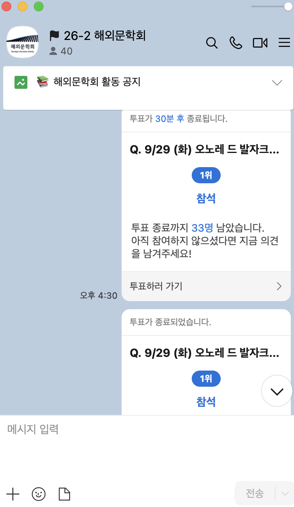

# 읽고, 잇다 — 해외문학회의 읽기와 대화를 잇는 웹사이트

기준일: 2026년 10월 21일.

> **이 사이트는 구글 시트와 연결되어 있습니다.** 동아리가 쓰는 「26-2 주간세미나」 시트의 일정이 그대로 사이트에 뜨고, 회원이 사이트에서 신청하면 운영 구글 시트의 `세미나 신청` 탭에 바로 기록됩니다. 책장은 운영 시트의 `도서 목록`(민음사 세계문학전집 484권)·`대출 기록`을, 독서 지도와 토론 기록도 같은 시트를 읽고 씁니다. 별도 데이터베이스 없이, 시트에 붙인 Google Apps Script 웹 앱이 사이트와 시트를 잇습니다. 2026-10-21 공개 사이트와 연결해 실제 신청·취소까지 확인했습니다([6. 검증 기록](#6-검증-기록)).

## 1. 목적과 서비스 배경

해외문학회 회장으로 동아리를 운영하면서, 매주 반복되는 일의 상당 부분이 **사람이 직접 세고, 확인하고, 공지하는 일**이라는 것을 느꼈습니다. 이 일을 작은 웹 서비스로 바꾸는 것이 이 프로젝트의 목적입니다.

### 동아리는 지금 이렇게 운영됩니다

- **세미나가 자주 열립니다.** 한 회원이 작품을 골라 발제하고 함께 토론하는 세미나를 오후 6시에 동아리방에서 엽니다. 26-2학기 주간세미나 시트를 보면 9월 7일부터 10월 8일까지 다섯 주 동안 10번, 한 주에 두 번꼴로 열렸습니다.
- **발제 일정은 이미 구글 시트로 관리합니다.** 회원이 공유 시트에 원하는 날짜와 작품을 직접 적고, 선착순으로 발제 일정이 정해집니다. 일정 변경은 세미나 일주일 전까지, 발제자 노쇼는 활동 정지 1개월처럼 운영 규칙도 시트에 적혀 있습니다.
- **참석 신청은 카카오톡 투표로 받습니다.** 11명이 차면 회장인 제가 직접 투표를 종료합니다.
- **책은 동아리가 소장한 민음사 세계문학전집을 빌려 갑니다.** 대출과 반납은 동아리방의 수기 명부에 적습니다.

### 실제로 겪은 문제

**1. 12번째 사람은 누구였을까 — 세미나 정원**

동아리방에는 발제자를 포함해 11명까지만 앉을 수 있습니다. 그래서 카카오톡 투표가 11명이 되면 제가 직접 '투표 종료'를 눌렀습니다. 그런데 종료를 누르고 보니 12명이 투표해 있던 적이 있습니다. 제가 확인하는 사이에 한 명이 더 누른 것입니다. 카카오톡 투표만으로는 누가 마지막으로 눌렀는지 분명하게 알기 어려워서, 선착순 원칙을 지키려 해도 누구에게 양해를 구해야 할지 애매했습니다. 정원을 지키는 일이 회장이 화면을 지켜보다가 제때 누르는 수작업에 달려 있었고, 이 일이 한 주에 두 번씩 반복됐습니다.



*지금까지 이렇게 세미나 참석을 받았습니다. 40명이 있는 단체 채팅방에서 세미나마다 '참석' 투표를 올리고, 인원이 차면 회장이 직접 종료했습니다.*

**2. 사라진 대출 명부 — 도서 대출**

대출과 반납은 동아리방의 수기 명부에 적었습니다. 그런데 그 명부가 사라진 적이 있습니다. 명부가 없으니 어떤 책을 누가 빌려 갔는지, 지금 동아리에 남아 있는 책이 무엇인지 확인할 방법이 없어 곤란했습니다. 기록이 한 권의 종이에만 있으면, 그 종이를 잃는 순간 기록 전체를 잃습니다.

**3. 좋았던 토론이 매번 날아간다 — 세미나 대화**

독서토론은 내용이 정말 좋습니다. 하지만 세미나가 끝나면 그 대화는 항상 기록 없이 사라졌습니다. 한 학기에 스무 번 가까이 모여도, 우리가 무엇을 이야기했는지 돌아볼 수 있는 것이 남지 않았습니다.

**4. 각자 아는 좋은 곳 — 회원 사이의 연결**

회원마다 좋아하는 서점과 북카페가 있지만, 각자의 네이버 지도에만 저장되어 있습니다. 저는 내가 좋아하는 곳을 알려 주고 다른 회원이 좋아하는 곳을 보는 것만으로도 회원끼리 더 가까워지고, 사람 사이의 연결이 생길 수 있다고 생각했습니다. 취향이 비슷한 사람들끼리 서로의 장소를 공유하면 세미나 밖에서도 이어질 수 있습니다.

### 해결 방향

1. **정원은 사람이 아니라 서버가 지킵니다.** 회원이 웹에서 이름과 확인번호로 신청하면 서버가 신청을 한 줄로 세워 차례대로 자리를 채우고, 11명이 되는 순간 다음 신청을 받지 않습니다. 동시에 눌러도 한 명만 마지막 자리를 얻습니다. 12번째 사람이 생길 수 없고, 누가 몇 시에 신청했는지 시트에 남습니다. 취소하면 그 자리가 바로 다시 열립니다.
2. **기록은 종이 한 장이 아니라 시트에 남깁니다.** 대출·반납, 신청 명단, 토론 기록, 장소를 모두 구글 시트에 쌓아 잃어버릴 일이 없게 했습니다. 동아리가 이미 쓰는 주간세미나 시트는 고치지 않고 그대로 읽으므로 운영진이 새로 배울 것이 없습니다.
3. **좋았던 토론을 남깁니다.** 받아쓰기 텍스트로 그날 많이 나온 낱말을 워드클라우드로, 함께 던진 질문을 카드로 남깁니다. 한 학기가 끝나면 동아리의 대화 기록이 됩니다.
4. **서로의 장소로 이어집니다.** '독서 지도'에 동아리가 아끼는 곳을 모으고, 회원이 좋아하는 곳을 추천하면 '회원 추천'으로 지도에 올라갑니다. 관련 책을 누르면 책장으로 이어집니다.
5. **가입 없이, 이름은 지키며.** 동아리 규모에서 회원 가입은 오히려 장벽이 되므로 로그인을 두지 않았습니다. 신청자·빌린 사람의 이름은 공개하지 않고, 발제자 이름도 첫 글자만 보이게 가립니다. 사이트에 들를 때마다 읽을거리가 있도록 매일 바뀌는 '오늘의 한 문장'도 넣었습니다.

## 2. 주요 사용자

**세미나에 참석하려는 해외문학회 회원**입니다. 회원 가입 없이 이용합니다. 핵심 흐름은 **세미나 찾기 → 이름·확인번호로 신청 → 인원 확인 → (필요하면) 같은 이름·확인번호로 취소**입니다. 운영진은 구글 시트에서 일정·대출·장소를 관리하고, 토론 기록은 운영진 코드로 올립니다.

## 3. 공개 주소와 기능

- 공개 주소: https://ilgo-itda.vercel.app/
- GitHub 저장소: https://github.com/hgehgehge-art/ilgo-itda
- 서버(Apps Script 웹 앱): https://script.google.com/macros/s/AKfycbytQ_nsPLZDbGlWWj8VUQKZd79e-NwpDYcMMPy55V0mheealqZbhd5DaaZxpQkM-2my8w/exec (사이트가 부르는 공개 주소. 예: 주소 뒤에 `?action=seminars`)

| 화면 | 기능 |
| --- | --- |
| [세미나](https://ilgo-itda.vercel.app/seminars.html) | 주간세미나 시트의 일정, 신청 인원(예: 7/11), 이름·확인번호 4자리로 신청·취소. 정원은 동아리방 수용 인원인 11명(발제자 포함) |
| [책장](https://ilgo-itda.vercel.app/books.html) | 민음사 세계문학전집 제목·작가·권번호 검색, 대출 가능한 책만 보기, 반납 예정일 |
| [독서 지도](https://ilgo-itda.vercel.app/places.html) | 서점·북카페·도서관·작품 속 장소를 지도 핀과 목록으로. 분류·회원 추천 필터, 관련 책으로 이동, 좋아하는 곳 추천 |
| [그날의 토론](https://ilgo-itda.vercel.app/discussions.html) | 받아쓰기 텍스트로 키워드 워드클라우드, 요약·질문·남기고 싶은 말, 운영진 코드로 저장·게시 |

## 4. 사용·실행·수정 방법

**회원이 세미나 신청하기:** 세미나 화면에서 '접수 중'인 카드의 '신청하기' → 이름과 확인번호 4자리(숫자) → '신청'. 인원이 바로 늘어납니다. 취소는 같은 카드의 '신청 취소'에 같은 이름·확인번호를 넣습니다. 확인번호를 잊으면 운영진에게 요청합니다.

**운영진이 토론 기록 올리기:** 토론 화면 아래 '토론 기록 만들기'에서 세미나를 고르고 받아쓰기 텍스트를 붙여 넣은 뒤 '키워드 뽑기' → 필요 없는 낱말은 눌러서 빼기 → 요약·질문을 다듬고 운영진 코드로 '초안 저장' 또는 '게시'.

**회원이 장소 추천하기:** 독서 지도 아래 '좋아하는 곳 추천하기'에 이름·주소·분류·이유를 적고 확인란을 체크해 보냅니다. 보내자마자 '회원 추천'으로 지도에 핀이 생깁니다. 맞지 않는 글은 운영진이 시트의 '게시' 칸을 '반려'로 바꿔 내립니다.

### 구글 시트 연결

| 사이트 화면 | 연결된 구글 시트 | 읽기 / 쓰기 |
| --- | --- | --- |
| 세미나 일정 | 「26-2 해외문학회 주간세미나」 시트1 (동아리가 원래 쓰던 시트, 고치지 않음) | 읽기 |
| 세미나 신청·취소·인원 | 운영 시트 `세미나 신청` 탭 | 읽기·쓰기 (신청 즉시 한 줄 추가, 취소 시 '취소 시각' 기록) |
| 책장 | 운영 시트 `도서 목록`(484권)·`대출 기록` 탭 | 읽기 |
| 그날의 토론 | 운영 시트 `토론 기록` 탭 | 읽기·쓰기(운영진 코드) |
| 독서 지도 | 운영 시트 `독서 지도` 탭 | 읽기·쓰기(회원 추천은 바로 게시) |

운영진은 사이트를 고치지 않고 시트만 고치면 됩니다. 주간세미나 시트에 일정을 적으면 1분 안에 사이트에 신청 카드가 생기고, 신청자 명단은 운영 시트에서 바로 볼 수 있습니다. 운영 시트는 공유하지 않은 비공개 시트이고, 사이트에는 이름을 뺀 정보만 나갑니다.

### 구조: 구글 시트 백엔드(Apps Script)

별도 서버나 데이터베이스 없이, 동아리가 이미 쓰는 구글 시트를 데이터 저장소로 씁니다. 운영 시트에 붙인 Apps Script(`apps-script/Code.gs`)를 '웹 앱'으로 배포하면 인터넷 주소가 하나 생기고, 사이트는 이 주소로만 읽고 씁니다.

```
회원 브라우저 (Vercel: HTML·CSS·JavaScript)
      │  읽기 GET ?action=…   쓰기 POST {action: …}
      ▼
Apps Script 웹 앱 (제작자 구글 계정 권한으로 실행)
      │  잠금(LockService)으로 신청을 한 줄로 세움 · 확인번호 해시 · 이름 가림 · 1분 캐시
      ├─▶ 주간세미나 시트(동아리 원본, 읽기만)
      └─▶ 운영 시트(비공개): 세미나 신청 · 도서 목록 · 대출 기록 · 토론 기록 · 독서 지도
GitHub Actions ─▶ 오늘의 한 문장(매일 명언 API에서 받아 저장)
```

| 요청 | 하는 일 | 돌려주는 것 |
| --- | --- | --- |
| `GET ?action=seminars` | 주간세미나 시트를 읽어 일정으로 바꿈 | 일정(발제자 이름은 첫 글자만), 세미나별 신청 수 |
| `GET ?action=books` | 도서 목록·대출 기록으로 상태 계산 | 책 목록, 대출 여부, 반납 예정일(빌린 사람 이름 없음) |
| `GET ?action=discussions` | 게시된 토론 기록 | 키워드·요약·질문·남기고 싶은 말(원문 없음) |
| `GET ?action=places` | 게시된 장소, 빈 좌표는 주소로 찾아 채움 | 장소 목록과 좌표 |
| `POST reserve` / `cancel` | 잠금을 건 뒤 정원·중복·시작 여부를 확인하고 저장 | ok · duplicate · full · closed · invalid / ok · not_found · closed |
| `POST saveDiscussion` / `loadDiscussion` | 운영진 코드 확인 후 저장·불러오기 | ok · bad_code · too_short 등 |
| `POST suggestPlace` | 중복·글자 수·하루 횟수 확인 후 바로 게시 | published · duplicate · missing 등 |

왜 Apps Script인가: 처음에는 Supabase(외부 데이터베이스)를 썼지만 무료 프로젝트가 사용이 뜸하면 일시 정지되어 사이트의 신청이 멈췄습니다. 구글 시트는 운영진이 이미 쓰는 도구라 따로 관리할 서버가 없고, 신청 명단을 시트에서 바로 볼 수 있으며, 카드 등록 없이 무료로 쓸 수 있습니다.

### 처음 설정(운영진, 한 번)

1. 구글 드라이브에서 새 스프레드시트 「읽고, 잇다 운영 (비공개)」를 만듭니다. 링크 공유는 켜지 않습니다.
2. 확장 프로그램 → Apps Script에 `apps-script/Code.gs`를 붙여 넣고 저장합니다.
3. 스프레드시트를 새로 고치면 위쪽에 **'읽고, 잇다'** 메뉴가 생깁니다. ① 처음 설정(탭 만들기) ② 세미나 시트 연결(주간세미나 시트 주소 붙여 넣기) ③ 운영진 코드 정하기를 차례로 실행합니다. 처음 실행 때 권한 허용 창이 뜹니다.
4. Apps Script 편집기에서 배포 → 새 배포 → 유형 '웹 앱', 실행 사용자 '나', 액세스 권한 '모든 사용자' → 배포. 나온 `…/exec` 주소를 `assets/js/config.js`의 `APPS_SCRIPT_URL`에 넣고 올립니다.
5. 메뉴의 **④ 도서 목록 채우기(민음사 세계문학전집)**를 누르면 `도서 목록` 탭에 공식 목록 484종이 들어갑니다(`sheets/book-list-draft.csv`). 실물과 다른 권은 지우고, 같은 책이 두 권이면 줄을 추가합니다.

운영 시트의 탭: `세미나 신청`(신청자 명단. 대리 취소는 '취소 시각' 칸에 시각을 적음) · `도서 목록` · `대출 기록`(빌려줄 때 한 줄, 반납받으면 실제 반납일) · `토론 기록` · `독서 지도`(회원 추천은 바로 '게시'로 올라감. 내리려면 '반려'. 위도·경도는 비워 두면 주소로 자동 채움).

### 내 컴퓨터에서 실행

Node.js 20 이상에서 저장소 폴더를 열고 실행한 뒤 http://localhost:8000 을 엽니다. `APPS_SCRIPT_URL`이 비어 있으면 가짜 응답으로 신청·토론 저장을 시험할 수 있습니다(토론 운영진 코드는 `local-test`).

```sh
node scripts/serve.mjs
```

| 수정할 내용 | 위치 |
| --- | --- |
| 소개·문구·디자인 | `index.html`, 각 HTML, `assets/css/style.css` |
| 세미나 일정·작품·발제자 | 주간세미나 구글 시트 |
| 신청자 명단·대리 취소, 대출·반납, 장소 게시 | 운영 구글 시트 |
| 서버 동작(신청 규칙, 시트 읽기) | `apps-script/Code.gs` (고친 뒤 '배포 관리 → 새 버전'으로 다시 배포) |
| 서버 주소 | `assets/js/config.js` |
| 토론 키워드 규칙 | `assets/js/keywords.js` |
| 오늘의 한 문장 | `scripts/update-quote.mjs`, `.github/workflows/daily-quote.yml` |

## 5. 데이터 출처와 갱신

| 데이터 | 출처·이용 조건 | 갱신 |
| --- | --- | --- |
| 세미나 일정 | 동아리 「26-2 주간세미나」 구글 시트(원본은 읽기만 함). 시간·장소·정원이 없으면 18시·동아리방·11명 | 서버가 최대 1분 저장 후 다시 읽음 |
| 신청 기록 | 운영 시트 `세미나 신청` 탭(비공개). 확인번호는 솔트를 넣은 SHA-256 해시로만 저장 | 신청 즉시 |
| 책 목록 | [민음사 세계문학전집 시리즈 목록](https://minumsa.minumsa.com/book_series/world-literatures/) 기준 484종(2026-10-04 확인) | 운영진이 시트 수정 |
| 대출 상태 | 운영 시트 `대출 기록` 탭(비공개). 빌린 사람 이름은 서버 밖으로 내보내지 않음 | 서버가 최대 1분 저장 |
| 토론 기록 | 운영진이 올린 받아쓰기 텍스트. 원문은 비공개, 발언자는 '참석자 A'로 익명 | 운영진 게시 시 |
| 독서 지도 | 운영진·회원이 적은 장소. 좌표는 Apps Script 지도 서비스로 주소에서 찾음. 지도는 [OpenStreetMap](https://www.openstreetmap.org/copyright)(ODbL), 표시 라이브러리 Leaflet | 운영진 게시 시 |
| 오늘의 한 문장 | [한국어 명언 API](https://github.com/gwongibeom/korean-advice-open-api)(자체 라이선스, 비상업적 사용) | 매일 0시 5분 GitHub Actions |

인증키는 GitHub Secrets에만 둡니다. 사이트 코드의 `APPS_SCRIPT_URL`은 공개 주소이며 비밀값이 아닙니다. 운영진 코드는 시트 메뉴에서 정하고 해시만 저장합니다. 발제자 이름은 첫 글자만 보이게 가려서 내보냅니다(예: 홍○○).

## 6. 검증 기록

| 입력 | 기대 결과 | 실제 결과 | 판단 | 근거 |
| --- | --- | --- | --- | --- |
| 실제 주간세미나 시트(CSV)를 서버 코드로 읽기 | 일정 10건, 휴회·빈 주차 제외, 날짜가 ID | 10건, 10/7 『호출』 ID 2026-10-07 | 통과 | `node tests/apps-script.test.mjs`(가짜 구글 환경), 2026-10-20 |
| 서버 응답 전체 | 발제자 실명 없음 | 첫 글자+○만 있음 | 통과 | 같은 시험 |
| 빈 이름 / 확인번호 '12a4' / 없는 세미나 | invalid | invalid | 통과 | 같은 시험 |
| 같은 이름 다시 신청(앞뒤 공백 포함) | duplicate | duplicate | 통과 | 같은 시험 |
| 회원 10명 신청 후 11번째 | 인원 10(화면 11/11), full | 10, full | 통과 | 같은 시험 |
| 틀린 확인번호 / 없는 이름으로 취소 | 둘 다 not_found | not_found | 통과 | 같은 시험 |
| 지난 세미나 신청·취소 | closed | closed | 통과 | 같은 시험 |
| 신청 기록 시트 | 확인번호 원문 없음, ID가 날짜로 바뀌지 않음 | 해시만, 글자로 저장 | 통과 | 같은 시험 |
| 대출 기록(미반납 1건, 2건, 반납) | 대출 중+예정일 / 대출 중(날짜 없음) / 대출 가능 | 일치, 빌린 사람 이름 없음 | 통과 | 같은 시험 |
| 토론: 틀린 코드, 짧은 글, 키워드 41개 | bad_code, too_short, invalid | 일치 | 통과 | 같은 시험 |
| 토론 게시 후 공개 목록 | 1건, 원문 없음 | 일치 | 통과 | 같은 시험 |
| 장소 추천: 빈 이름, 없는 분류, 이유 101자, 같은 장소 | missing, invalid_category, too_long, duplicate | 일치 | 통과 | 가짜 구글 환경 시험 |
| 장소 추천 직후 / '반려'로 바꾼 뒤 | 바로 지도에 나오고 좌표가 시트에 채워짐 / 지도에서 내려감 | 일치 | 통과 | 같은 시험 |
| 지도 화면에 장소 3곳(1곳 좌표 없음) | 핀 2개, 안내 문구, 회원 추천 필터 1곳 | 일치, 팝업 열림 | 통과 | 로컬 Chrome, 2026-10-20 |
| 추천 양식 빈칸·'4권'·javascript: 링크·확인란 미체크 | 각 이유 안내 | 일치 | 통과 | 로컬 Chrome |
| 5개 화면, 360px | 가로 넘침 없음 | 없음(메뉴 5개 포함) | 통과 | 로컬 Chrome |
| 토론 키워드(예시 받아쓰기) | 자주 나온 낱말, 말끝 제외 | 가족 6·쓸모 3 등, '거죠' 제외 | 통과 | 로컬 Chrome |
| '예시로 체험하기'(가상 『변신』 토론 883자) | 키워드·요약·질문·인용·미리보기 자동, 인용은 원문 그대로, 게시 차단 | 가족 13·그레고르 5·쓸모 4·돌봄 3·사랑 3 …, 인용 3개 모두 원문에 있음, '저장·게시할 수 없어요' 안내 | 통과 | 로컬 Chrome, 2026-10-21 (처음엔 '안에서·제일·것도'가 섞여 제외 목록에 추가) |
| 시트 메뉴 '도서 목록 채우기' | 484권이 탭에 들어가고 책장이 읽음 | 484권, 10권 『한국단편문학선 1』 | 통과 | 가짜 구글 환경 |
| 이전 서버(Supabase) 주소 요청 | 응답 | 주소 없음(NXDOMAIN, 무료 프로젝트 일시 정지) | 실패 → 구글 시트 백엔드로 교체 | 2026-10-20 |
| 배포한 Apps Script에 읽기 요청 5종(ping·seminars·books·discussions·places) | 모두 JSON 응답 | 모두 HTTP 200, 2~4초. 일정 10건, 발제자 이름 가림 | 통과 | curl, 2026-10-21 00:08 |
| 배포한 서버에 지난 세미나 신청·취소 / 없는 세미나 / 확인번호 '12a4' | closed / invalid / invalid | 일치 | 통과 | curl, 2026-10-21 |
| 배포한 서버에 틀린 운영진 코드 / 빈 장소 추천 | bad_code / missing | 일치 | 통과 | curl, 2026-10-21 |
| 공개 사이트 세미나 화면(브라우저에서 Apps Script 호출) | 실제 일정 표시 | 10건 표시. 처음 약 15초 걸려 요청 수를 줄임 | 통과·개선 | Chrome, 2026-10-21 |
| 운영 시트 메뉴 '도서 목록 채우기' 실행 후 책장 요청 | 484권, 10권 『한국단편문학선 1』 | 일치 | 통과 | 배포 서버, 2026-10-21 00:21 |
| 주간세미나 시트에 11/2 일정 추가 | 사이트 일정에 '접수 중'으로 나타남 | 11/2 김영하 『호출』, 발제자 가림 | 통과 | 배포 서버, 2026-10-21 00:21 |
| 11/2 세미나에 점검용 이름으로 신청 → 같은 이름 다시 → 틀린 확인번호 취소 → 맞는 확인번호 취소 | ok·인원 1 → duplicate → not_found → ok·인원 0 | 일치 | 통과 | 배포 서버, 2026-10-21 00:23 |
| 같은 세미나에 3명이 동시에 신청 → 모두 취소 | 셋 다 ok·인원 3(빠짐 없음) → 인원 0 | 일치(약 7.8초) | 통과 | 배포 서버, 2026-10-21 |
| 마지막 한 자리에 여러 명 동시 신청 | 한 명만 ok | 실제 서버에서는 미확인(가짜 구글 환경과 잠금 코드로 확인) | 확인 필요 | 실제 명단에 점검 기록 10줄이 남아 생략 |

'가짜 구글 환경 시험'(`node tests/apps-script.test.mjs`)은 시트·캐시·잠금·해시를 흉내 낸 로컬 환경에서 `apps-script/Code.gs`를 그대로 실행한 47개 항목입니다. 시험용 일정 파일은 실제 시트 구조에 가상 이름을 넣은 것입니다. 실제 구글 서버에서의 동작, 특히 동시 신청 잠금은 배포 후 다시 확인해야 합니다. 이전 화면 점검 결과는 [docs/mvp-check-results.json](docs/mvp-check-results.json)에 있습니다.

## 7. 알려진 한계

- 이름과 확인번호는 엄밀한 본인 인증이 아닙니다. 다른 사람 이름으로 신청하는 것을 막지 못해 운영진이 명단을 확인합니다. 확인번호가 4자리라 여러 번 시도하면 맞힐 수 있습니다.
- Apps Script는 응답이 1~3초 걸릴 수 있고, 구글 계정의 하루 사용량 한도가 있습니다. 동아리 규모에서는 충분합니다.
- 서버가 응답하지 않으면 세미나 일정은 공개 시트를 직접 읽어 보여 주지만, 이때는 신청을 받지 않습니다. 주간세미나 시트는 '링크가 있는 모든 사용자' 공유라, 원본에서는 발제자 이름이 보입니다.
- 토론 키워드는 단어 빈도 규칙이라 형태소 분석만큼 정확하지 않습니다. 요약·질문은 운영진이 직접 쓰고 확인한 뒤 게시합니다.
- 네이버 지도 개인 저장 목록은 가져오는 공개 API가 없어, 운영진이 시트에 옮겨 적습니다.
- 대출 상태는 운영진이 시트에 적은 만큼만 정확합니다. 2026-10-21 기준 빌려 간 책이 없어 모두 '대출 가능'이며, 빌려줄 때마다 `대출 기록` 탭에 한 줄을 적어야 합니다. 운영 시트를 읽지 못하면 책장은 민음사 공식 목록만 보여 주고 대출 상태는 '확인 중'으로 표시합니다.

## 8. 참고 자료와 AI 도움

- 과제 안내: 「개인 홈페이지 과제 안내」 2026 v5, 「중간 MVP 과제 안내 및 평가 기준」 2026, 「읽고, 잇다 — 독서토론 기록 기능 기획」.
- 참고 문서: [Apps Script 웹 앱](https://developers.google.com/apps-script/guides/web), [Apps Script LockService](https://developers.google.com/apps-script/reference/lock/lock-service), [Leaflet](https://leafletjs.com/), [OpenStreetMap 타일 이용 정책](https://operations.osmfoundation.org/policies/tiles/).
- **AI 도움:** OpenAI Codex로 기능 범위·이용 흐름을 정리하고, 일정 직접 조회·토론/장소 파일 만들기·화면 점검 코드를 만들었습니다. Claude Code(Anthropic)로 화면, 구글 시트 백엔드(`apps-script/Code.gs`)와 그 시험, 토론 키워드 워드클라우드, 독서 지도를 만들고 점검했습니다. 이전 기록은 [docs/implementation-history.md](docs/implementation-history.md)에 있습니다.
- **본인이 정하고 확인한 것:**
  - **문제 정의:** 카카오톡 투표를 11명에서 직접 종료했는데 12명이 되어 있던 일, 수기 대출 명부가 사라진 일, 좋았던 토론이 기록 없이 사라지는 일, 회원끼리 좋아하는 장소를 나누면 더 가까워질 수 있겠다는 생각은 제가 회장으로 겪고 생각한 것입니다. 이 경험을 바탕으로 기능의 우선순위를 정했습니다.
  - **범위와 규칙:** 정원은 동아리방에 앉을 수 있는 11명(발제자 포함)으로, 로그인 없이 이름과 확인번호로 신청하도록 정했습니다. 토론 기록은 녹음 파일 대신 받아쓰기 텍스트로 받고, 독서 지도의 회원 추천은 운영진 확인을 기다리지 않고 바로 지도에 올라가게 했습니다. 책장은 동아리가 소장한 민음사 세계문학전집 목록을 그대로 쓰도록 했습니다.
  - **디자인:** 애플 웹사이트의 분위기를 참고하고, 강조색은 해외문학회 로고의 남색으로 정했습니다. 로고의 기울어 이어지는 책 모양을 홈 첫 화면에 쓰게 했습니다.
  - **구조 결정:** 처음 연결한 Supabase가 일시 정지되어 신청이 멈추는 것을 겪었고, Google Cloud는 결제 정보 등록에서 막혔습니다. 그래서 운영진이 이미 쓰는 구글 시트만으로 운영하는 구조를 골랐습니다.
  - **직접 설정한 것:** 운영 시트를 만들고 Apps Script 코드를 붙여 넣어 권한을 허용했고, 주간세미나 시트 연결, 운영진 코드 설정, 웹 앱 배포, 도서 목록 채우기(484권)를 제 구글 계정으로 직접 했습니다.
  - **직접 확인한 것:** 주간세미나 시트에 일정을 올리면 사이트에 신청 카드가 뜨는 것, 책장에 전집 목록이 나오는 것, 독서 지도에 추천한 장소가 올라가는 것을 공개 사이트에서 확인했습니다. README가 평가 기준(개인정보, 미완성 표시, 다섯 열 검증 기록)에 맞는지 검토해 고치도록 요청했습니다.
  - **AI와 나눈 역할:** 코드 작성과 점검은 AI 도구가 했고, 무엇을 만들지·어떤 순서로·어떤 규칙으로 할지는 제가 정했습니다. AI가 만든 결과는 공개 사이트와 시트에서 직접 확인했습니다.
